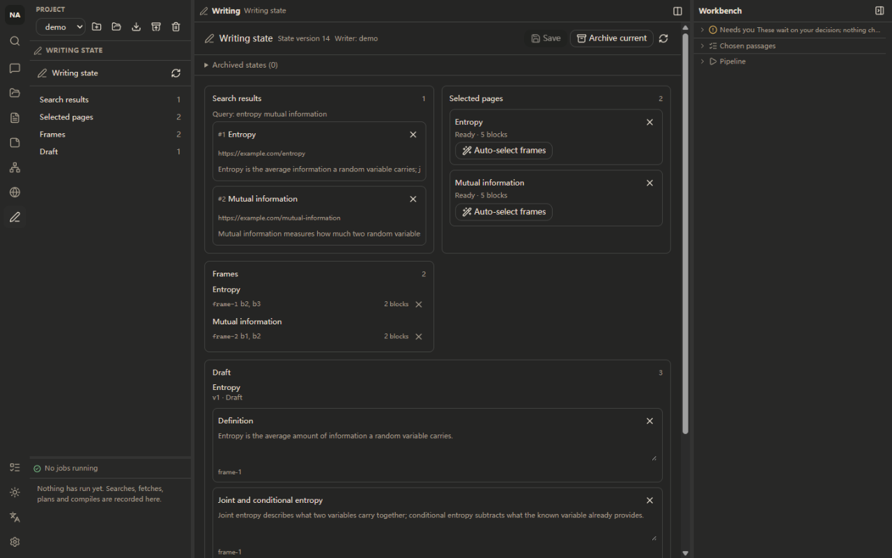
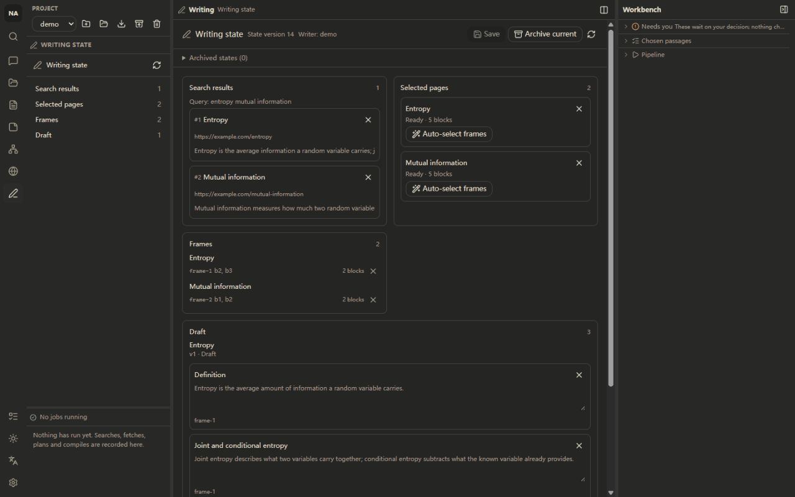
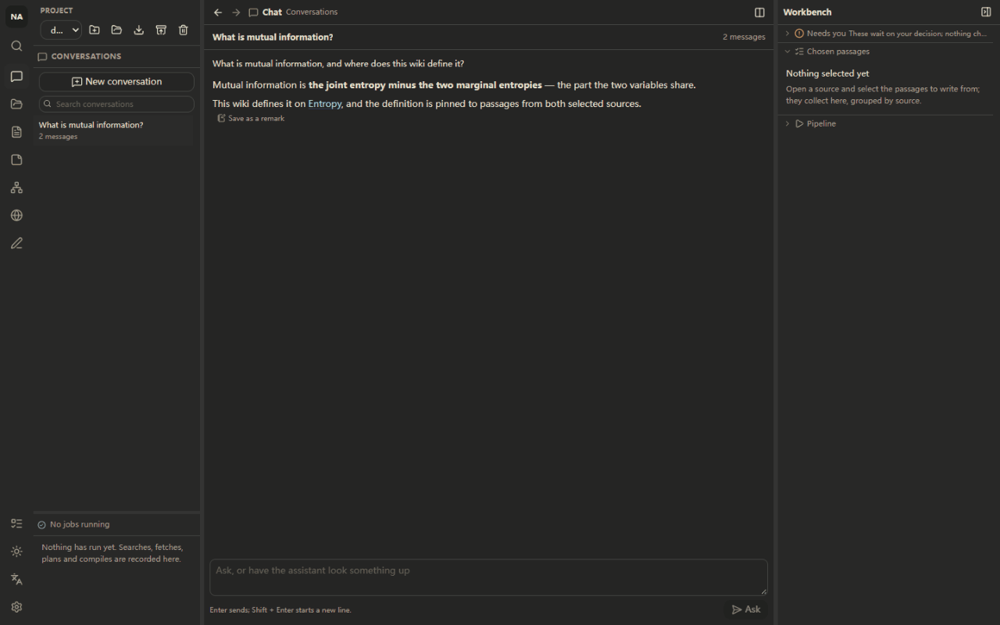

# NOTEAGENT

A local agent that turns the sources you choose into a cited Markdown wiki.

> **Status:** early development. The Windows desktop app runs end to end; interfaces and
> on-disk formats may still change.
>
> [Download for Windows](https://github.com/JcmXiF/NoteAgent/releases/latest) · [中文](README.zh-CN.md)

[](https://github.com/JcmXiF/NoteAgent/releases)
[](LICENSE)



*The writing panel: the agent's draft, its sections, and the sources behind them.*

## How it works

- **You choose the sources.** Web pages, PDFs, Office files, images, Markdown. They land in
  `raw/`, which is immutable: the model reads it, never writes it.
- **The agent drafts in the open.** It searches, selects pages, frames the passages that matter,
  and composes sections in the project's writing state. You can edit the same state.
- **Publishing is explicit.** `write_wiki` publishes one draft version. Every page carries
  `sources[]` locators (`path#block_id`) back to the passage it came from.

Your project stays on disk and the core binds to loopback. The only outbound calls are your
model, the optional search provider, and the pages you fetch.

It is not a chat client for your notes; the wiki is the artifact. The conversation is how you
direct it.



*From a chosen source to a published page.*



*Ask the wiki; the answer cites the pages it read.*

## Use it

### Install

Download the Windows installer from [Releases](https://github.com/JcmXiF/NoteAgent/releases/latest).
It carries its own Python runtime; nothing else needs to be installed.

On first launch, open Settings (the gear) and fill in the model connection. A search provider is
optional; without one, only the material you add by hand is collected.

### Your first page

1. Create a project.
2. Add sources: search the web, open a page in the built-in browser when it needs a login, or add a
   local file or a paste.
3. Ask the agent to write, for example: “Write a page about … from the sources I kept.”
4. Review the draft in the writing panel, edit it if you want, and publish.

### Ask the wiki

Ask a question in the chat. The agent searches and reads the wiki, then answers with citations.
When the wiki does not cover something, it says so instead of filling the gap.

Retrieval is optional. When the wiki grows past a full-text scan, turn it on under
Settings → Retrieval; the same `search` tool then answers from a hybrid index.

## Build it

- Python 3.12
- Node.js 20.19+ (or 22.12+ on the 22 line)
- An OpenAI-compatible model endpoint; a search key is optional

```bash
conda env create -f environment.yml && conda activate noteagent && pip install -e ".[api]"
cd web && npm install
cd ../desktop && npm install
```

Run the three processes in this order:

```bash
python -m noteagent.api          # core, http://127.0.0.1:8765
cd web && npm run dev            # interface, http://127.0.0.1:5174
cd desktop && npm run dev        # shell
```

The order is not cosmetic: the shell reads the interface's address once, so Vite has to be
answering first. Full setup, the check suite, packaging and the configuration reference are in
[docs/public/development.md](docs/public/development.md).

## Documentation

| Document | Contents |
|---|---|
| [architecture](docs/public/architecture.md) | The core, the interface, the shell, and the project on disk |
| [development](docs/public/development.md) | Setup, checks, packaging, configuration reference |
| [provenance](docs/public/provenance.md) | What this design owes to earlier work and its GPL-3.0 reference |
| [AGENTS.md](AGENTS.md) | The conventions agents follow in this repository |
| [evals/rag](evals/rag/README.md) | The retrieval measurement harness |

## Contributing

Bug fixes and small corrections are welcome as a pull request; a new feature is worth an issue
first. Before opening one, run `node scripts/check.mjs` and, if you touched the agent,
`python -m evals`. Both are local; CI runs the mechanical checks. The contribution rules — one
concern per change, tests next to logic, user-facing text in the i18n catalogs — are in
[docs/public/development.md](docs/public/development.md).

## License

MIT — see [LICENSE](LICENSE).
