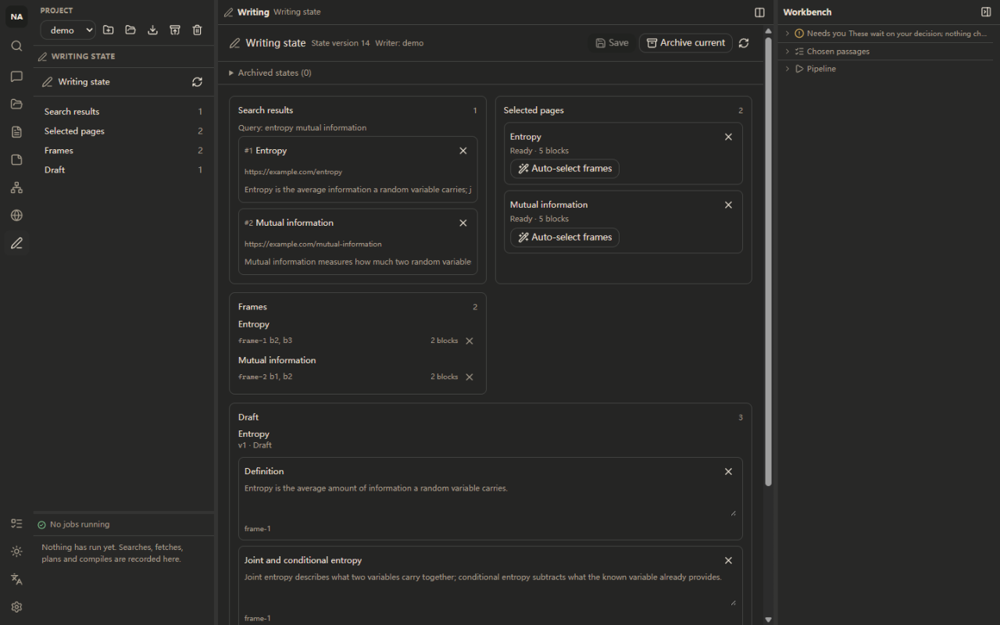
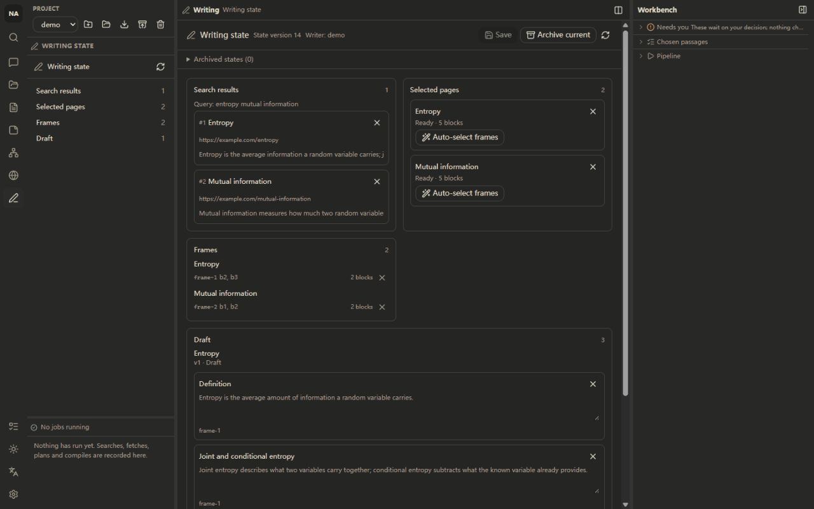
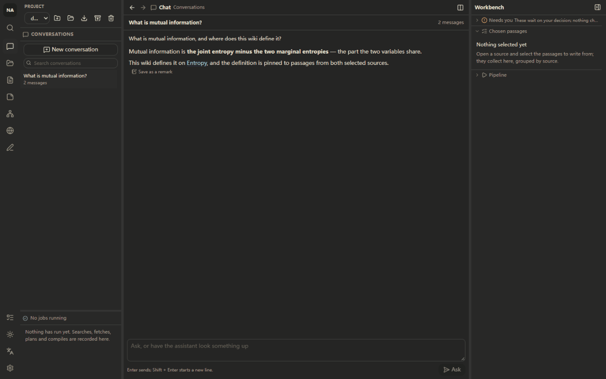

# NOTEAGENT

一个本地 agent，把你选中的资料变成一座带引用的 Markdown wiki。

> **状态：** 早期开发。Windows 桌面版已端到端可用；接口与磁盘格式仍可能变化。
>
> [下载 Windows 版](https://github.com/JcmXiF/NoteAgent/releases/latest) · [English](README.md)

[](https://github.com/JcmXiF/NoteAgent/releases)
[](LICENSE)



*写作面板：agent 的草稿、它的分节，以及这些内容背后的来源。*

## 它怎么工作

- **你决定资料。** 网页、PDF、Office 文件、图片、Markdown。它们落在 `raw/` 里，而 `raw/` 是不可变的：模型只读，不写。
- **agent 在明处起草。** 它搜索、选页、画框，把重要的段落圈出来，再在项目的写作状态里组装成分节草稿。你可以编辑同一份状态。
- **发布是显式的。** `write_wiki` 发布一个草稿版本。每个页面都带 `sources[]` 定位（`path#block_id`），指回它来自的那段原文。

项目留在磁盘上，核心只绑定 loopback。唯一的对外请求是你的模型、可选的搜索服务，以及你主动抓取的页面。

它不是给笔记用的聊天客户端；wiki 才是产物，对话只是你指挥它的方式。



*从选中的资料到发布后的页面。*



*问 wiki；回答会引用它读过的页面。*

## 使用

### 安装

从 [Releases](https://github.com/JcmXiF/NoteAgent/releases/latest) 下载 Windows 安装包。它自带 Python 运行时，不需要另装任何东西。

第一次打开后，进入设置（图标栏里的齿轮）填写模型连接。搜索服务是可选的；不配也行，只是只能使用你手动添加的资料。

### 第一页

1. 新建一个项目。
2. 添加资料：搜索网页；需要登录的页面用内置浏览器打开；也可以添加本地文件或粘贴内容。
3. 让 agent 写一页，例如：“用我留下的资料写一页关于……的内容。”
4. 在写作面板里检查草稿，需要就改，然后发布。

### 问 wiki

在对话里提问。agent 会搜索并读取 wiki，然后带引用回答。wiki 没覆盖的内容，它会直接说没有，而不是补一个看起来合理的答案。

检索是可选的。当 wiki 大到全文扫描不够用时，在 设置 → 检索 里打开；同一个 `search` 工具会改从混合索引回答。

## 构建

- Python 3.12
- Node.js 20.19+（22 线用 22.12+）
- 一个 OpenAI 兼容的模型端点；搜索 key 可选

```bash
conda env create -f environment.yml && conda activate noteagent && pip install -e ".[api]"
cd web && npm install
cd ../desktop && npm install
```

按这个顺序启动三个进程：

```bash
python -m noteagent.api          # 核心，http://127.0.0.1:8765
cd web && npm run dev            # 界面，http://127.0.0.1:5174
cd desktop && npm run dev        # 外壳
```

顺序不是形式：外壳只读一次界面的地址，所以 Vite 必须先应答。完整 setup、检查、打包和配置表在
[docs/public/development.md](docs/public/development.md)。

## 文档

| 文档 | 内容 |
|---|---|
| [architecture](docs/public/architecture.md) | 核心、界面、外壳，以及项目在磁盘上的样子 |
| [development](docs/public/development.md) | Setup、检查、打包、配置参考 |
| [provenance](docs/public/provenance.md) | 这个设计欠了哪些早期工作，以及它与 GPL-3.0 参考的差异 |
| [AGENTS.md](AGENTS.md) | 这个仓库里 agent 遵守的约定 |
| [evals/rag](evals/rag/README.md) | 检索测量 harness |

## 贡献

Bug 修复和小修正欢迎直接开 PR；新功能先开 issue 聊一下。提交前跑 `node scripts/check.mjs`；如果动了 agent，再跑 `python -m evals`。两者都在本地跑，CI 只跑机械检查。贡献规则——一次只做一件事、测试放在逻辑旁边、用户可见文本走 i18n catalog——在
[docs/public/development.md](docs/public/development.md)。

## 许可

MIT — 见 [LICENSE](LICENSE)。
